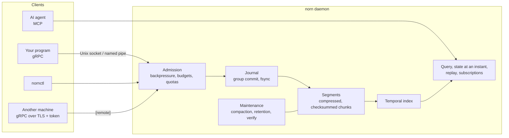

<!--
SPDX-FileCopyrightText: 2026 Srikanth K
SPDX-License-Identifier: AGPL-3.0-or-later
-->

<div align="center">

<h1>Norn</h1>

<p><strong>A pure-Rust, domain-independent temporal data engine.</strong><br>
It keeps the history of sensor data and device telemetry, answers what any signal held at any instant, and replays it.</p>

<p>
<a href="https://github.com/shokki-engineering/norn/actions/workflows/ci.yml"></a>
<a href="https://github.com/shokki-engineering/norn/releases"></a>
<a href="protobuf"></a>
<a href="#installation"></a>
<a href="rust-toolchain.toml"></a>
<a href="#licence"></a>
</p>

<p>
<a href="#installation">Install</a> &middot;
<a href="#quick-start">Quick start</a> &middot;
<a href="#contents">Documentation</a> &middot;
<a href="docs/project/changelog.md">Changelog</a> &middot;
<a href="docs/project/plan.md#roadmap">Roadmap</a> &middot;
<a href="SECURITY.md">Security</a>
</p>

</div>

Norn is a single local daemon. Programs send it timestamped samples over gRPC. It
journals them, compresses them losslessly into checksummed chunks, indexes them by
time, and answers range queries, aggregates, the state of every signal at an instant,
and deterministic replays. It knows entities, signals and streams, and never what they
mean.

> [!NOTE]
> **Latest release: [v1.0.0-rc.3](https://github.com/shokki-engineering/norn/releases/tag/v1.0.0-rc.3), 16 November 2026**, the third release candidate for 1.0.
> It adds a daemon-wide disk budget, remote gRPC over TLS with a bearer token, and
> hard per-stream quotas. The daemon, `nornctl`, the adapters, the MCP server and the
> protocol crate are versioned together at `1.0.0-rc.3`, and the wire protocol is 1.9.
> See the [changelog](docs/project/changelog.md).

> [!IMPORTANT]
> **Upgrading from 1.0.0-rc.2.** Setting the first stream quota moves the metadata log
> to version 3, which 1.0.0-rc.2 does not open; a database that never sets one stays
> readable by it. A volume with 256 MiB or less free now refuses batches, unless
> `min_free_bytes = 0` ([configuration](docs/guides/configuration.md)).

## Why Norn

Many systems need the same thing from their sensor data: keep years of it on one
machine, lose nothing that was acknowledged, and answer "what did the system look like
at 08:00:15, and what happened around it?" quickly. Norn does that one job, for any
domain.

- **One process, local by default.** A daemon owns a data directory and serves an
  owner-only Unix socket or named pipe. No external database, and no network listener
  unless you configure one.
- **Domain-independent.** The engine knows entities, signals, streams, samples,
  timestamps, sequences and quality. No device, protocol or industry term appears in
  it; domain facts travel as opaque annotations.
- **Time first.** Storage, indexing, queries, state at an instant and replay are all
  organised around time.
- **Nothing acknowledged is lost.** `DURABLE` means fsynced. Crash recovery, checksums
  on every chunk, and verification that reads every byte back.
- **Bounded.** Every memory budget, count and disk limit is configured and enforced.
  When one runs out, clients are slowed or refused, never silently dropped.
- **A pure-Rust engine.** The engine reaches no C, a plain build needs no C compiler,
  and `unsafe` is denied workspace-wide but for one Windows security descriptor. Remote
  gRPC's TLS is the one exception, linked into `norn` and `nornctl` only
  ([architecture](docs/reference/architecture.md#no-c)).

## How it works



Every client reaches storage through the same gRPC API: MCP calls it in process, and
nothing reaches storage another way while the daemon runs. Each path has a diagram in
[architecture](docs/reference/architecture.md#the-system-at-a-glance), and the ideas
behind them are in [how Norn works](docs/guides/concepts.md).

## Features

Status is one of Done, Experimental, Planned or Not built.

**Ingest**

| Feature | Status | Notes |
| --- | --- | --- |
| Append over gRPC, with backpressure and acknowledgement levels | Done | `ACCEPT`, `BUFFER`, `THROTTLE`, `REJECT`; `BUFFERED` to `DURABLE` |
| Batch creates | Done | `BatchCreateEntities`, `BatchCreateSignals`: up to 1,000 a call, all or none |
| Shared-memory data plane | Done | Opt-in, Unix sockets only, transparent socket fallback ([shared memory](docs/reference/shared-memory.md)) |
| Device adapter kit, `norn-sink` | Done | Bounded buffer, retries, catalogue at start ([device adapter](docs/guides/device-adapter.md)) |
| Further device-protocol adapters | Planned | As clients of the public API, outside this repository |

**Storage and durability**

| Feature | Status | Notes |
| --- | --- | --- |
| Journal, group commit, fsync | Done | `DURABLE` only after `fsync` returns |
| Compressed, checksummed chunks | Done | Delta-of-delta, Gorilla, ALP, dictionaries, zstd levels 3 to 6 |
| Sparse temporal index | Done | Rebuilt from the segments if lost |
| Crash recovery | Done | Tested by killing the process, not by cutting power |
| Disk budget | Done, 1.0.0-rc.3 | `min_free_bytes` and `max_disk_bytes` refuse batches before the disk fills ([storage](docs/reference/storage.md#disk-budget)) |
| Encryption at rest | Experimental | Opt-in, unreviewed, its on-disk form may change within 1.x ([storage](docs/reference/storage.md#encryption)) |

**Query, state and replay**

| Feature | Status | Notes |
| --- | --- | --- |
| Range queries, filters, aggregates, resume tokens | Done | Sees samples as soon as they are acknowledged |
| State at an instant (`StateAt`) | Done | From the index |
| Deterministic replay and live subscriptions | Done | Virtual clock: pause, seek, step, speed; one [known issue](#status-and-known-issues) |
| Pattern detection, GGML-accelerated | Planned | Opt-in, outside the engine; scope to be decided |

**Operations**

| Feature | Status | Notes |
| --- | --- | --- |
| Compaction, retention, verification | Done | In the background and on demand; size retention applies as segments seal ([operations](docs/guides/operations.md)) |
| Hard per-stream quotas | Done, 1.0.0-rc.3 | Refuse batches at a stream's quota, delete nothing ([operations](docs/guides/operations.md#quotas)) |
| Backup, restore, migration | Done | `nornctl backup` while running; `restore` and `migrate` offline ([operations](docs/guides/operations.md#backup-and-restore)) |
| Compatibility policy | Done | Versioned formats, golden stores read on every CI run ([compatibility](docs/reference/compatibility.md)) |
| Homebrew package and background service | Done | `brew services start norn` ([Homebrew](docs/guides/homebrew.md)) |
| Metrics export | Not built | |

**Interfaces**

| Feature | Status | Notes |
| --- | --- | --- |
| `nornctl` command-line client | Done | Every operation, plus `inspect`, `stats`, `benchmark` ([nornctl](docs/reference/cli.md)) |
| Remote gRPC over TLS, with a bearer token | Done, 1.0.0-rc.3 | `[remote]`, off by default; `nornctl --remote` ([configuration](docs/guides/configuration.md#remote-grpc)) |
| Import and export: CSV, Parquet, Arrow IPC, MCAP | Done | Through `nornctl`, over the public API ([import and export](docs/guides/import-export.md)) |
| MCP for AI agents, served by the daemon | Done | `norn --mcp`, 17 read-only tools, off by default ([AI agents](docs/guides/ai-agents.md)) |

**Quality and security**

| Feature | Status | Notes |
| --- | --- | --- |
| Fuzzing | Done | 26 targets, one per decoder of untrusted bytes, run nightly ([SECURITY.md](SECURITY.md#fuzzing)) |
| Security review | Done | One source review, not an external audit ([review](docs/security/review-2026-11.md)) |
| Benchmark matrix | Done | A quick profile runs in CI; the full run is still to be made ([performance](docs/performance.md#benchmark-matrix)) |

## Installation

### Homebrew (macOS and Linux)

The tap and archives are public; no GitHub token is needed.

```sh
brew install shokki-engineering/tap/norn
brew services start norn
nornctl --endpoint "unix:$(brew --prefix)/var/run/norn/norn.sock" status
```

The service starts at login, restarts after a crash, keeps data in
`$(brew --prefix)/var/norn` and reads `$(brew --prefix)/etc/norn/norn.toml`. After
`brew upgrade norn`, run `brew services restart norn`
([Homebrew](docs/guides/homebrew.md)).

### Release archives

Archives for Linux (x86-64, AArch64), macOS (Apple silicon, Intel) and Windows
(x86-64), each with a `.sha256` file, are on the
[releases page](https://github.com/shokki-engineering/norn/releases). Each holds `norn`,
the daemon, and `nornctl`, the client, built with remote gRPC.

### From source

With Rust 1.99.1 (pinned in `rust-toolchain.toml`) and `protoc`:

```sh
git clone https://github.com/shokki-engineering/norn.git
cd norn
git checkout v1.0.0-rc.3
cargo build --release --locked -p norn-server -p norn-cli
```

This builds `target/release/norn` and `target/release/nornctl` with no C compiler.

| Build | Command | Needs |
| --- | --- | --- |
| Plain, local IPC only | `cargo build --release --locked -p norn-server -p norn-cli` | Rust and `protoc` |
| As release archives, with remote gRPC | add `--features norn-server/remote,norn-cli/remote` | also a C compiler, for `ring` |

Prerequisites and the platform list are in
[getting started](docs/guides/getting-started.md#build).

## Quick start

Start the daemon in one terminal (`./target/release/norn`, or the Homebrew service
with its `--endpoint` added to each call). In another, create a catalogue, append, and
ask what a signal held at an instant:

```console
$ nornctl streams create plant
streams/plant
$ nornctl entities create dev-01
entities/dev-01
$ nornctl signals create dev-01 temperature plant double
entities/dev-01/signals/temperature
$ nornctl append plant entities/dev-01/signals/temperature 21.0 --at 2026-11-02T08:00:00Z --sequence 1
BACKPRESSURE_OUTCOME_ACCEPT ACKNOWLEDGEMENT_LEVEL_BUFFERED
BACKPRESSURE_OUTCOME_ACCEPT ACKNOWLEDGEMENT_LEVEL_DURABLE
$ nornctl state dev-01 --at 2026-11-02T08:00:15Z
state_time: 2026-11-02T08:00:15Z
2026-11-02T08:00:00Z entities/dev-01/signals/temperature 21 GOOD seq=1
```

Each batch hears its admission, then the level it reached. The output was captured
from Norn 0.1.0; the commands are unchanged. Queries, aggregates, replay, verification,
compaction, export and import are in the
[longer walk-through](docs/guides/getting-started.md#a-longer-walk-through).

## Status and known issues

1.0.0-rc.3 is a release candidate: the owner field-tests it before tagging 1.0.0. What
is built, measured and planned, stage by stage, is in the
[roadmap](docs/project/plan.md#roadmap).

- **Replay.** A maximum-speed replay of a recent window may stop after `RUNNING`;
  under investigation.
- **Encryption at rest is experimental.** It has had no independent review, and its
  on-disk form may change within 1.x, so it is outside the
  [compatibility promise](docs/reference/compatibility.md#what-1x-promises). A backup of
  an encrypted store that holds no segment yet loses its encryption marker, so
  restoring it without a key opens it as plain.
- **Crash tests cover process death** (`kill -9`), not power loss. Every performance
  figure is from macOS; Linux and Windows are tested in CI, not measured.
- **The disk budget is measured every second.** Norn's own writes stop at
  `min_free_bytes` exactly; another program's writes, and `max_disk_bytes`, are caught
  at the next measurement. If the disk does fill, nothing acknowledged is lost, but the
  stream refuses batches until the daemon restarts
  ([troubleshooting](docs/guides/troubleshooting.md#no-space-left-on-device-then-this-streams-storage-failed)).

## Security

Report vulnerabilities privately, through GitHub's private vulnerability reporting
([SECURITY.md](SECURITY.md)). Every decoder of untrusted bytes is fuzzed nightly, and
one source review has been done, with findings still open
([review](docs/security/review-2026-11.md)).

| Listener | Who can reach it |
| --- | --- |
| Unix socket or named pipe (the default) | The daemon's own user only |
| `listen = "tcp:..."` (loopback only) | Every local user, with no authentication; the daemon warns at start |
| MCP over HTTP (loopback only) | Every local user, with no authentication; the daemon warns at start |
| `[remote]` | Other machines, over TLS, and only with the bearer token ([configuration](docs/guides/configuration.md#remote-grpc)) |

Prefer the Unix socket, a named pipe, MCP over stdio, or `[remote]` with its token.
Encryption at rest is opt-in and experimental, and covers sample data, not names or
time ranges ([storage](docs/reference/storage.md#encryption)).

## Contents

**Guides**

| Guide | What it covers |
| --- | --- |
| [Getting started](docs/guides/getting-started.md) | Build, run, create, append, list, and a longer walk-through |
| [How Norn works](docs/guides/concepts.md) | The ideas, one at a time, with screenshots |
| [Using Norn from your own code](docs/guides/clients.md) | gRPC, `nornctl` and MCP as clients, locally and remotely |
| [Homebrew](docs/guides/homebrew.md) | Installation, the background service, upgrades, release automation |
| [Configuration](docs/guides/configuration.md) | Every key and its default |
| [Ingesting data](docs/guides/ingesting-data.md) | Batches, acknowledgements, backpressure |
| [Operations](docs/guides/operations.md) | The data directory, recovery, verify, compaction, retention, quotas, backup, migration |
| [Troubleshooting](docs/guides/troubleshooting.md) | Real errors and what they mean |
| [Querying](docs/guides/querying.md) | Ranges, filters, aggregates, resuming |
| [Replay and state](docs/guides/replay.md) | State at an instant, replay, live subscriptions |
| [Import and export](docs/guides/import-export.md) | CSV, Parquet, Arrow, MCAP, both ways |
| [AI agents](docs/guides/ai-agents.md) | `norn --mcp` and a client configuration |
| [Writing a device adapter](docs/guides/device-adapter.md) | `norn-sink`, step by step, with a complete example |

**Reference**

| Reference | What it covers |
| --- | --- |
| [Architecture](docs/reference/architecture.md) | The system at a glance, write and read paths, layers, dependencies, process model |
| [Protocol](docs/reference/protocol.md) | The gRPC API, errors, versioning |
| [Storage](docs/reference/storage.md) | File format, encryption, write path, recovery, index, codecs, disk budget |
| [Compatibility](docs/reference/compatibility.md) | On-disk format versions, the protocol, the support window, what 1.x promises |
| [IPC](docs/reference/ipc.md) | Transports, endpoints, security model |
| [Shared memory](docs/reference/shared-memory.md) | The opt-in iceoryx2 data plane, its limits, trust boundary and crash handling |
| [Query](docs/reference/query.md) | Read path, `StateAt`, exact semantics, bounds |
| [Replay](docs/reference/replay.md) | Virtual clock, sessions, subscriptions, bounds |
| [Adapters](docs/reference/adapters.md) | The contract, and the CSV, Parquet, Arrow and MCAP formats |
| [nornctl](docs/reference/cli.md) | Every command and option |
| [MCP](docs/reference/mcp.md) | The daemon's 17 read-only tools and their transports |

**Project and security**

| Document | What it covers |
| --- | --- |
| [Changelog](docs/project/changelog.md) | Every release, v0.1.0 to v1.0.0-rc.3 |
| [Plan](docs/project/plan.md) | How the work is split, its status and the roadmap |
| [Specification](docs/project/spec.md) | The binding brief |
| [Performance](docs/performance.md) | The benchmark matrix, every measurement and how it was made |
| [Security review, November 2026](docs/security/review-2026-11.md) | Threat model, findings, fixes, what was not examined |

**Screenshots**, captured from a real daemon by
[`tools/screenshots/capture.sh`](tools/screenshots/capture.sh):
[status](docs/images/nornctl-status.svg), [version](docs/images/nornctl-version.svg),
[signals](docs/images/nornctl-signals.svg), [append](docs/images/nornctl-append.svg),
[query](docs/images/nornctl-query.svg), [streams](docs/images/nornctl-streams.svg).

## Contributing

Read [CONTRIBUTING.md](CONTRIBUTING.md) first. In short: no source file reaches 200
lines, no C in the engine, no new `unsafe`, and `just ci` must pass, repository gates
included. Every gate fails when it examined nothing, and each has a test proving it
bites.

```sh
just test    # every test, including those proving each gate bites
just lint    # cargo fmt --check and clippy -D warnings, with and without release features
just gates   # size, purity, docs, arch, deps
just ci      # everything CI runs
```

`xtask docs` also checks this README: every relative link and anchor resolves, the
contents list every file under `docs/` and nothing else, and the README holds no emoji
or other pictograph.

## Licence

Copyright &copy; 2026 Srikanth K. All rights reserved, except as granted below.

Norn is dual-licensed:

- **[AGPL-3.0-or-later](LICENSE)** for open-source use.
- **[Commercial](LICENSE-COMMERCIAL.md)** for proprietary use under a separate agreement.

This covers every part of Norn, with no exception: the engine, the server, the client
and protocol crates, their generated code, and the `.proto` definitions under
[`protobuf/`](protobuf). A proprietary client built on any of them needs a commercial
licence.

Contributions follow the [Contributor Licence Agreement](.github/CLA.md); sign off each
commit with `git commit -s`. Third-party dependencies keep their own licences, which
`deny.toml` keeps permissive. SPDX headers, the generated MCP handlers' terms and the
licence files in release archives are described in
[CONTRIBUTING.md](CONTRIBUTING.md#licence-and-contributions).
